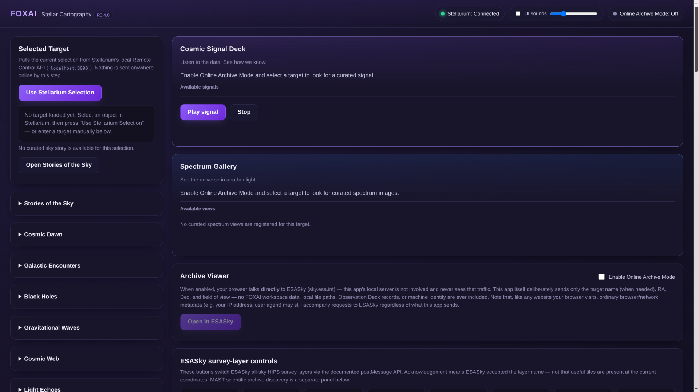
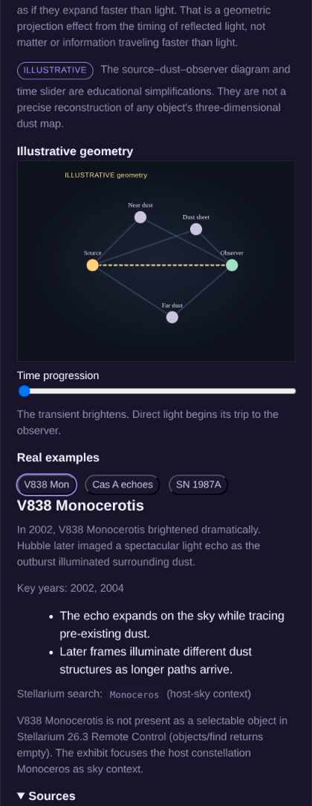
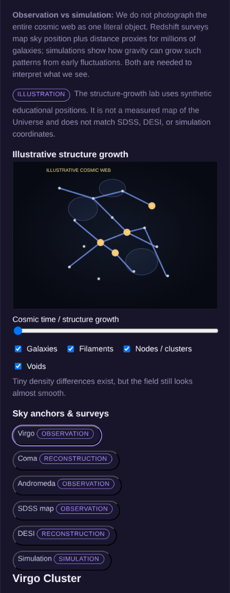
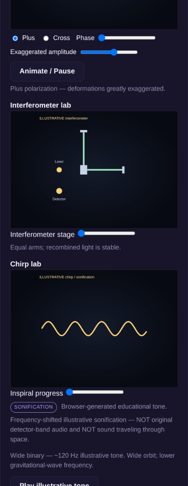
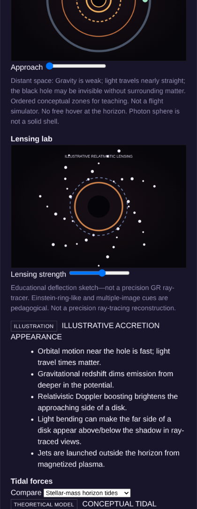
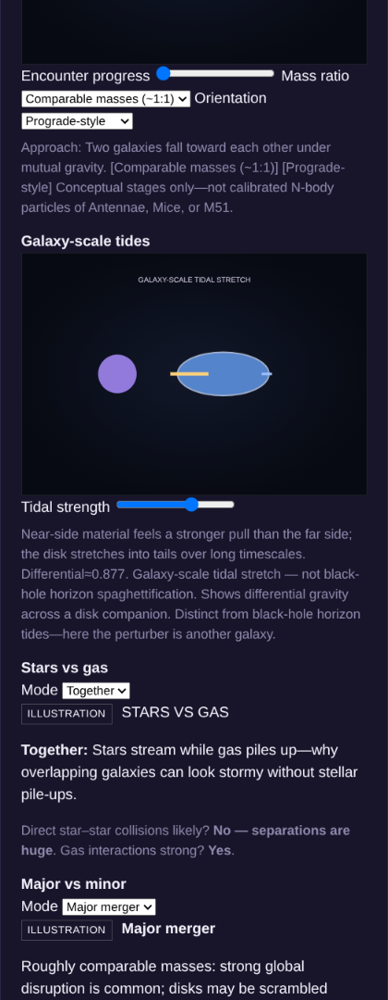
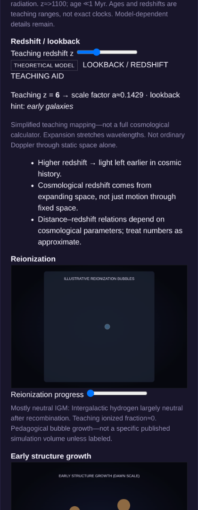

# Stellar Cartography

**Browser-based educational bridge for [Stellarium](https://stellarium.org/)** — select sky objects, open archive viewers, run curated **Stories of the Sky** and six **Specials**, with optional local narration/TTS.

> **Status:** Six Specials complete (Light Echoes → Cosmic Dawn). Public repository: [github.com/kayock/stellar-cartography](https://github.com/kayock/stellar-cartography). Stellarium is an **external** dependency. **MIT License** — see [`LICENSE`](LICENSE). Third-party media retain their own terms ([`docs/MEDIA_PROVENANCE.md`](docs/MEDIA_PROVENANCE.md)).

New here? Start with **[`START_HERE.md`](START_HERE.md)** or **[`docs/PUBLIC_INSTALL.md`](docs/PUBLIC_INSTALL.md)**.

---

## Features

- **Stellarium Remote Control** integration (exact name, host-sky, or coordinate hosting)
- **Stories of the Sky** / constellation tours and exhibit flows
- **Six Specials:** Light Echoes · Cosmic Web · Gravitational Waves · Black Holes · Galactic Encounters · Cosmic Dawn
- **NASA / Chandra / ESA / survey media** via remote URLs and provenance fields (not bundled binaries)
- **Optional local TTS** (Father Fox / Kayock Voice style HTTPS endpoints on loopback)
- **Stdlib-only Python runtime** (Python ≥ 3.9) — no pip packages required to run

### Screenshots

Live captures from the running UI (application content only).



| [Light Echoes](docs/LIGHT_ECHOES.md) | [Cosmic Web](docs/COSMIC_WEB.md) | [Gravitational Waves](docs/GRAVITATIONAL_WAVES.md) |
|:---:|:---:|:---:|
| [](docs/images/special-light-echoes.png) | [](docs/images/special-cosmic-web.png) | [](docs/images/special-gravitational-waves.png) |

| [Black Holes](docs/BLACK_HOLES.md) | [Galactic Encounters](docs/GALACTIC_ENCOUNTERS.md) | [Cosmic Dawn](docs/COSMIC_DAWN.md) |
|:---:|:---:|:---:|
| [](docs/images/special-black-holes.png) | [](docs/images/special-galactic-encounters.png) | [](docs/images/special-cosmic-dawn.png) |

Optional: [Stories of the Sky](docs/images/stories-of-the-sky.png)

---

## Six Specials

| Special | Doc |
|---------|-----|
| Light Echoes | [docs/LIGHT_ECHOES.md](docs/LIGHT_ECHOES.md) |
| Cosmic Web | [docs/COSMIC_WEB.md](docs/COSMIC_WEB.md) |
| Gravitational Waves | [docs/GRAVITATIONAL_WAVES.md](docs/GRAVITATIONAL_WAVES.md) |
| Black Holes | [docs/BLACK_HOLES.md](docs/BLACK_HOLES.md) |
| Galactic Encounters | [docs/GALACTIC_ENCOUNTERS.md](docs/GALACTIC_ENCOUNTERS.md) |
| Cosmic Dawn | [docs/COSMIC_DAWN.md](docs/COSMIC_DAWN.md) |

---

## Quick start

```bash
git clone https://github.com/kayock/stellar-cartography.git
cd stellar-cartography
python3 -m venv .venv && source .venv/bin/activate
pip install -r requirements.txt   # documents Python ≥3.9; installs nothing else
cp .env.example .env              # optional documentation of env vars

./start.sh --host 127.0.0.1 --port 8775 --stellarium-url http://127.0.0.1:8090
```

**Windows:** `Start_Stellar_Cartography.bat` (legacy name `Start_FOXAI_Stellar_Cartography.bat` remains as a wrapper).

Open `http://127.0.0.1:8775`. Full install, multi-machine Stellarium, and troubleshooting: **[docs/PUBLIC_INSTALL.md](docs/PUBLIC_INSTALL.md)**.

### Configuration

| Variable / flag | Purpose | Example |
|-----------------|---------|---------|
| `--host` / `STELLAR_CARTOGRAPHY_HOST` | Bind address | `127.0.0.1` or `0.0.0.0` |
| `--port` / `STELLAR_CARTOGRAPHY_PORT` | UI port | `8775` |
| `--stellarium-url` / `STELLAR_CARTOGRAPHY_STELLARIUM_URL` | Remote Control base | `http://127.0.0.1:8090` |
| `STELLAR_CARTOGRAPHY_TTS_HOSTS` | Extra TTS allowlist hosts | unset (loopback only) |

Public launcher template: [`start-production.example.sh`](start-production.example.sh).

### Prerequisites

- Python **3.9+**
- **Stellarium** with **Remote Control** plugin enabled
- Modern browser
- Optional: Node.js ≥ 18 for frontend unit tests only

---

## Architecture

```
Browser UI ──► Cartography (Python stdlib http.server)
                    │
                    ├── Stellarium Remote Control (HTTP)
                    ├── Official media / NASA proxies (optional online)
                    └── Local TTS HTTPS (optional, allowlisted)
```

Specials live under `app/*.py` + `app/data/*_registry.json` + `app/static/lib/*.js`.

---

## Tests

Python baseline (**513** tests):

```bash
python3 -m unittest discover -s tests -v
```

Optional frontend contracts (Node ≥ 18, no npm install):

```bash
node --test tests/frontend/*.test.js
```

---

## Provenance & license

- Media / agency attribution: [`docs/MEDIA_PROVENANCE.md`](docs/MEDIA_PROVENANCE.md)
- Project license: [`LICENSE`](LICENSE) (MIT)
- Security notes: [`SECURITY.md`](SECURITY.md)
- Contributing: [`CONTRIBUTING.md`](CONTRIBUTING.md)
- Project status: [`PROJECT_STATE.md`](PROJECT_STATE.md)

## History

Earlier R0.4.0 product documentation (ESASky bridge, archive lights, watchlist,
Apophis, and related change logs) is preserved under
[`docs/history/R0.4.0_PRODUCT_README.md`](docs/history/R0.4.0_PRODUCT_README.md).
